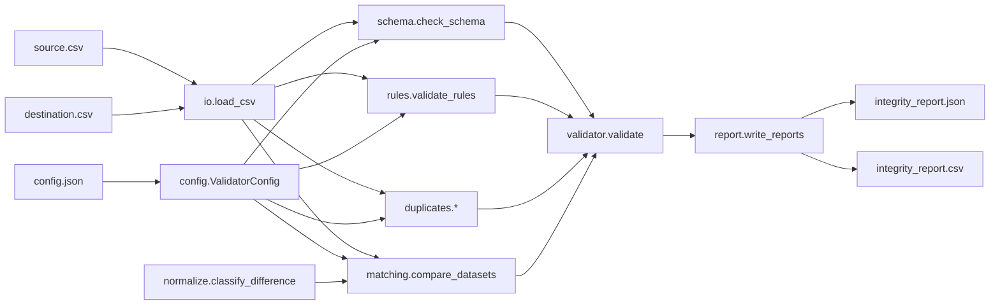

# Data Integrity Validator

**A Python toolkit for detecting hidden data errors after a migration.**

A migration can finish with no errors, a green status and matching row counts, and still leave the business with wrong data. This tool compares a **source** CSV with a **destination** CSV and reports every record that went missing, was duplicated, or changed on the way, with the record id, field, expected value, observed value and a severity.

> All data in this repository is **synthetic**. The tool runs entirely offline, uses only the Python standard library, and never uploads anything.

**What this project is, and is not.** It is a practical data-validation and verification tool, built from hands-on CRM migration and workflow-automation experience (including a Keap-to-HubSpot migration of 4,500+ contacts and 2,000+ deals). It is *not* a machine-learning model and does not claim ML research or model-development experience. Its relevance to ML and AI work is on the data side: checking that data is complete and correct, and designing checks whose results can be verified objectively.

## Why this exists

CRM and database migrations (for example Keap → HubSpot) usually report "import successful" when the *transfer* worked, not when the *data* is correct. Typical silent failures:

| What the import tool reports | What actually happened |
|---|---|
| 31 rows imported (source had 30) | 3 records dropped, 1 duplicated twice, 2 created from nothing |
| No errors | `4500.00` became `450.00` (decimal shift) |
| No errors | A blank email, a truncated email and a negative deal amount were imported |
| No errors | `2024-03-15` became `03/15/2024`, which sorts and filters differently |

Row counts and "success" flags cannot catch these. Record-level and field-level comparison can.

## Features

- **CSV ingestion** with explicit errors for missing files, bad encoding, ragged rows, empty or duplicate headers, and unterminated quotes. Everything is read as text, so `007` stays `007` and empty cells stay empty.
- **Schema validation**: missing columns, unexpected columns, incompatible column types.
- **Record matching** on a configurable key: one column or an explicit composite key (e.g. `first_name` + `last_name`). Case-sensitive or not. Null or incomplete keys are reported, never silently matched or dropped.
- **Missing- and unexpected-record detection.**
- **Duplicate detection**: repeated identifiers (identical vs conflicting) and the same content under different identifiers.
- **Field-level comparison** that separates genuine mismatches from whitespace and formatting differences.
- **Configurable integrity rules**: required fields, email format, numeric ranges, strict date formats, allowed-value lists, and explicit null tokens (e.g. `NULL`, `N/A`).
- **Safe normalization**: used only to *classify* differences. Input files and in-memory data are never modified, and every difference is still reported.
- **Reports**: deterministic JSON (machine-readable) and CSV (human-readable). Each issue has an id, severity, record, field, expected and observed values, an explanation, the normalization that applied (if any), and a suggested investigation or corrective action.
- **No third-party runtime dependencies.** Standard library only. `pytest` is needed only to run the tests.
- **CLI** with meaningful exit codes for use in CI or scripts.
- **Automated tests** with deliberately corrupted datasets and a hand-written answer key.

## Architecture



| Module | Responsibility |
|---|---|
| `io.py` | Strict CSV reading into immutable tuples; records physical line numbers and a SHA-256 of each input |
| `config.py` | Validated configuration; unknown keys are rejected so a typo cannot disable a rule |
| `schema.py` | Column presence and type compatibility |
| `rules.py` | Single-dataset integrity rules |
| `duplicates.py` | Blank/duplicate identifiers and duplicate records |
| `matching.py` | Key index (single or composite) and record-to-record comparison |
| `normalize.py` | Value parsing; classifies differences and names the normalization applied |
| `validator.py` | Orchestration and summary statistics |
| `report.py` | JSON and CSV output |
| `cli.py` | Argument parsing and exit codes |

### Design decisions

- **Nothing is silently discarded or overwritten.** Loaded data is held in immutable tuples. Blank lines skipped on load are counted in the report `notes`. Rows with a null or incomplete key are reported (`missing_identifier`). Suppressed formatting differences are counted in the summary. A rule that is skipped because its column is absent is recorded in `notes`.
- **Differences are classified, not lumped together.** A trailing space, a case change and a changed amount are different problems with different severities.
- **Deterministic output.** No timestamps, stable sort order, sorted JSON keys in configuration and summary. Identical inputs and configuration produce byte-identical reports (this is tested).
- **Provenance.** The report records the SHA-256 of both input files so a result can be tied to the exact data it was computed from.
- **Why no pandas.** The comparison logic needs row lookups and string handling, not dataframe features. Avoiding pandas/numpy removes compiled dependencies, which matters on older Intel Macs (at least some current numpy builds for Intel target much newer macOS versions than 10.15) and keeps installation to a single `pip install pytest`.
- **Privacy in output.** The console summary prints counts only, never record values. Error messages name files, line numbers and column names, not cell contents. Record values appear only in the report files you choose to write.
- **Fail loudly on bad setup.** Structural problems (cannot parse, id column missing) stop the run with exit code 2 and a specific message rather than producing a misleading partial report.

## Installation

Requires **Python 3.9 or newer** (3.12 or 3.13 recommended). There are no third-party runtime packages.

```bash
git clone https://github.com/ChuksTech22/data-integrity-validator.git
cd data-integrity-validator
python3 -m venv .venv
source .venv/bin/activate          # Windows: .venv\Scripts\activate
pip install -e ".[dev]"            # installs the CLI plus pytest
```

Without installing anything you can also run it straight from the checkout:

```bash
PYTHONPATH=src python3 -m data_integrity_validator --help
```

**Older Intel Macs (for example macOS 10.15 Catalina).** The system `python3` on old macOS can be too old. Install Python 3.12 or 3.13 from python.org, which provides installers for Intel Macs, then check `python3 --version` before creating the virtual environment. Because the tool is pure Python, there are no compiled wheels to build or download. The project has been developed and tested with Python 3.12 on Linux and syntax-checked for Python 3.9; it has not been run on macOS 10.15 itself.

## Usage

```bash
data-integrity-validator SOURCE.csv DESTINATION.csv [--config CONFIG.json] \
    [--key COLUMN [--key COLUMN ...]] [--output-dir DIR] \
    [--fail-on {error,warning,info,never}] [--quiet]
```

Equivalent: `python -m data_integrity_validator ...`

| Option | Meaning |
|---|---|
| `--config` | JSON configuration (see `examples/config.json`) |
| `--key` (alias `--id-column`) | Key column; repeat the flag for a composite key (`--key first_name --key last_name`). Overrides the config file. Default `id` |
| `--output-dir` | Report directory (default `reports`) |
| `--fail-on` | Exit 1 if any issue at or above this severity exists (default `error`) |
| `--quiet` | No console summary |

**Exit codes:** `0` nothing at/above the threshold · `1` issues found · `2` bad input, config or usage.

Help: `data-integrity-validator --help`.

### Configuration reference

```json
{
  "id_column": "contact_id",
  "id_case_sensitive": true,
  "ignore_columns": [],
  "required_fields": ["contact_id", "last_name", "email"],
  "email_fields": ["email"],
  "numeric_ranges": { "deal_amount": { "min": 0, "max": 1000000 } },
  "date_fields": { "signup_date": "%Y-%m-%d" },
  "allowed_values": { "lifecycle_stage": ["lead", "opportunity", "customer", "subscriber"] },
  "expected_types": { "phone": "string" },
  "normalization": {
    "strip_whitespace": true,
    "unicode_nfc": true,
    "casefold_fields": ["email"],
    "phone_fields": ["phone"],
    "numeric_fields": ["deal_amount"],
    "date_fields": ["signup_date"],
    "accepted_date_formats": ["%Y-%m-%d", "%m/%d/%Y"],
    "null_tokens": ["NULL", "N/A"],
    "report_formatting_differences": true
  },
  "severity_overrides": { "whitespace_difference": "info" }
}
```

For a composite key, use `"key_columns": ["first_name", "last_name"]` instead of `id_column` (setting both is an error). Unknown keys are rejected, so a typo cannot silently disable a rule. `examples/config.json` is a real, working configuration.

## Sample run

The `examples/` folder holds a 30-row synthetic source and a 31-row synthetic destination with **28 deliberately injected problems** (see `examples/known_errors.json`).

```bash
data-integrity-validator examples/source.csv examples/destination.csv \
    --config examples/config.json --output-dir reports
```

Output (copied from an actual run; the process exits with status 1 because errors were found):

```text
Source rows checked:       30
Destination rows checked:  31
Records matched by key:    27
Missing in destination:    3
Unexpected in destination: 2
Field values compared:     203
Issues detected:           28 (error=20, warning=5, info=3)
JSON report: reports/integrity_report.json
CSV report:  reports/integrity_report.csv
```

Issues by type (from `reports/integrity_report.json`): `value_mismatch` 7, `missing_record` 3, `formatting_difference` 3, `unexpected_record` 2, `duplicate_id` 2, and one each of `missing_column`, `unexpected_column`, `type_mismatch`, `duplicate_record`, `missing_value`, `whitespace_difference`, `rule_required_field`, `rule_email_format`, `rule_not_numeric`, `rule_numeric_range`, `rule_date_format`.

### Example report entries

```json
{
  "issue_id": "DIV-0006",
  "severity": "error",
  "issue_type": "value_mismatch",
  "dataset": "comparison",
  "record_id": "C009",
  "field": "deal_amount",
  "expected": "4500.00",
  "observed": "450.00",
  "explanation": "Value differs between source and destination.",
  "normalization": "",
  "suggested_action": "Compare the record in both systems, decide which value is correct, and fix the wrong side.",
  "source_line": 10,
  "destination_line": 9
}
```

A harmless difference is reported too, at a lower severity, and the report names the normalization that reconciled it:

```json
{
  "issue_id": "DIV-0026",
  "severity": "info",
  "issue_type": "formatting_difference",
  "dataset": "comparison",
  "record_id": "C003",
  "field": "email",
  "expected": "chidi.eze@example.com",
  "observed": "Chidi.Eze@Example.com",
  "explanation": "Values are equivalent after 'casefold' normalization but formatted differently: 'chidi.eze@example.com' vs 'Chidi.Eze@Example.com'. Without that normalization this would be a value mismatch.",
  "normalization": "casefold",
  "suggested_action": "Usually no action; standardize the format only if downstream systems are format-sensitive.",
  "source_line": 4,
  "destination_line": 4
}
```

The CSV report has the columns `issue_id, severity, issue_type, dataset, record_id, field, expected, observed, normalization, source_line, destination_line, explanation, suggested_action`. Line numbers are physical lines in the input file (line 1 is the header).

### Verifying the sample results independently

See `examples/README.md` for a table of every injected error and its expected outcome.

1. Open `examples/source.csv` and `examples/destination.csv` side by side and look up `C009`: `4500.00` vs `450.00`.
2. Compare the list in `examples/known_errors.json` with `reports/integrity_report.csv`. The test suite asserts they match exactly (no missing detections, no extra ones).
3. Confirm the report is reproducible. With the files in this repository, the reports generated by the command above have these SHA-256 values:

```text
2ad391a32dd5d652806f841910d84c4291b0daf4d87e45109577c965421ce5ed  integrity_report.json
ca3e73c30c5e4d8e95ce0230ca6324d7761c1883a1f9d9d7e29ecb8853147371  integrity_report.csv
```

(`sha256sum reports/*` on Linux/macOS, `Get-FileHash` on Windows. Git is configured via `.gitattributes` to keep LF line endings so the inputs hash identically on every platform.)

## How a "successful" transfer still produces wrong business data

The injected problems in the sample data mirror real migration failures:

| Injected problem | Records | Why a transfer tool does not complain | Business impact |
|---|---|---|---|
| Dropped records | C005, C011, C019 | Tool imports what it can; skipped rows are not errors | Lost customers and revenue history |
| Duplicate identical row | C007 | Two valid rows | Double-counted deals, duplicate outreach |
| Duplicate with conflicting email | C014 | Both rows are valid on their own | Which email is right? Wrong person is contacted |
| Copy under a new id | C032 | Looks like a new contact | Inflated contact counts |
| Record not in source | C031 | Valid row | Unverified data enters the CRM |
| Decimal shift | C009 `4500.00` → `450.00` | Still a valid number | Pipeline value understated 10x |
| Sign flip | C027 `250.00` → `-250.00` | Still a valid number | Negative revenue in reports |
| Number replaced by text | C018 `TBD` | Text fields accept anything | Numeric reports break or skip the row |
| Blank / truncated email | C020, C023 | Fields are optional or loosely typed | Contact unreachable, bounces |
| Date reformatted | C025 | Parsed as text | Sorting, filtering and automations misfire |
| Case, spacing, phone format | C003, C012, C016 | Cosmetic | Duplicates and failed lookups later |
| Dropped / added columns | `company`, `import_batch` | Mapping silently omitted a field | Missing context; stray metadata |

Here the row counts are 30 and 31. Close enough that nobody would look twice, yet 28 separate issues exist.

## Validation rules, assumptions and limitations

### Severity levels

| Severity | Meaning | Default for |
|---|---|---|
| `error` | Data is missing, wrong or violates a rule; needs action | `missing_record`, `missing_column`, `duplicate_id`, `value_mismatch`, `missing_value`, `type_mismatch`, `missing_identifier`, all `rule_*` (including `rule_allowed_value`) |
| `warning` | Probably unintended; needs a human decision | `unexpected_record`, `unexpected_column`, `duplicate_record`, `whitespace_difference`, `unexpected_value`, `identifier_formatting` |
| `info` | Equivalent value, different formatting | `formatting_difference` |

Any default can be changed with `severity_overrides`.

### Rule by rule

| Rule / check | How it works | Assumptions and limitations |
|---|---|---|
| **Schema: columns** | Exact, case-sensitive name match between files | A renamed column appears as one missing plus one unexpected column; no rename detection |
| **Schema: types** | Narrowest of `integer < decimal < date < string` that fits every non-blank value; source and destination must be compatible (integer≈decimal, empty fits anything) | Phone numbers, ZIP codes and similar values can look numeric. Use `expected_types` (e.g. `"phone": "string"`) to override. One bad value makes the whole column `string`, which is intended |
| **Key matching** | Stripped key (one column or a composite of several), optionally case-folded | Assumes the key is stable across systems. A row whose key (or any part of a composite key) is null cannot be matched and is reported as `missing_identifier` |
| **Missing / unexpected record** | Set difference on keys | Does not detect a record that was *replaced* by another with a different key |
| **Duplicate id** | Same identifier more than once in one file; says whether rows are identical or conflicting | Every destination duplicate is compared against the *first* source row; if the source also has duplicates, only its first row is used for comparison |
| **Duplicate record** | Different ids, identical content in all non-id columns (whitespace-insensitive) | Exact-content heuristic, not fuzzy matching ("Jon" vs "John" is not detected). Same-id rows are covered by `duplicate_id` |
| **Field comparison** | Raw values compared first; differences classified as whitespace, formatting, missing value, unexpected value or genuine mismatch | Only columns present in both files are compared. Whitespace-only counts as empty |
| **Whitespace** | Trim and collapse runs of whitespace (including non-breaking spaces) | Disable with `strip_whitespace: false` |
| **Formatting (opt-in per field)** | Case-fold, phone digits only, decimal equality (`1000` = `1000.00`), date equality across `accepted_date_formats`, Unicode NFC | Only for fields you list. Phone comparison keeps digits only, so `+2348035550016` and `08035550016` are *different*. Thousands separators and currency symbols are never guessed. Ambiguous dates such as `03/04/2024` follow the order of `accepted_date_formats`, so list only formats you know are in use |
| **Required field** | Blank, whitespace-only, or a configured null token | Checked on both files |
| **Null tokens** | `normalization.null_tokens` (e.g. `NULL`, `N/A`) are treated as "no value" by the required rule, key handling, type inference and comparison. Source `NULL` vs destination empty is reported as an info-level `formatting_difference` | Off by default (only blanks are null). Matching is case-insensitive; other placeholders such as `-` or `unknown` are never guessed |
| **Allowed values** | Value (stripped) must be in the configured list | Exact, case-sensitive match; null values are left to the required rule |
| **Email format** | Pragmatic pattern: local part, `@`, dotted domain, 2+ letter TLD; no leading/trailing/double dots | Format only. It does not prove the mailbox exists and rejects some unusual-but-legal RFC addresses |
| **Numeric range** | Inclusive min/max (either may be omitted); non-numeric values reported as `rule_not_numeric` | Plain decimals only (no `1,000`, no `$`) |
| **Date format** | Value must match the given `strptime` format exactly (so `2024-3-5` fails for `%Y-%m-%d`) and be a real calendar date | Month names depend on the system locale |

A single root cause can raise several issues by design (e.g. a blank email gives both `missing_value` from the comparison and `rule_required_field` from the rule). Each one answers a different question.

### Other limitations

- Whole files are loaded into memory; intended for datasets that fit comfortably in memory. Performance on very large files has not been benchmarked.
- Input must be UTF-8 CSV (a BOM is handled). Other encodings fail with an explicit error.
- Composite keys are matched exactly on all parts; there is no fuzzy or partial-key matching.
- The CSV report prefixes values starting with `=`, `+`, `-` or `@` with an apostrophe to prevent spreadsheet formula injection. The JSON report keeps raw values, so treat it as the authoritative record.
- Comparison is value-based. It cannot tell you *which* system is right, only that they disagree.

## Testing

```bash
pip install -e ".[dev]"
pytest -v
```

The tests include:

- **Ingestion edge cases**: missing/empty files, header-only files, BOM, invalid UTF-8, ragged rows, duplicate headers, blank lines, multi-line quoted fields, unterminated quotes, proof that input files and loaded data are never modified.
- **Schema and rule edge cases**: type inference, expected types, boundary values for ranges, strict dates, valid/invalid email tables, allowed values, null tokens.
- **Keys**: single and composite keys, duplicate and partially-null keys, missing key columns.
- **Classification table**: whitespace, NBSP, case, phone, decimal, date, Unicode and null-token differences.
- **Corrupted datasets**: dropped, duplicated and conflicting records with *equal row counts* that hide the errors.
- **Answer-key test** (`tests/test_example_dataset.py`): the validator must report exactly the 28 hand-listed errors in the sample data, with no false positives, and must report zero issues when a file is compared with itself.
- **Reporting**: JSON structure, CSV columns, issue ids, suggested actions, byte-identical reports across runs.
- **CLI**: exit codes, `--help`, thresholds, repeated `--key`, bad config, console output that never echoes record values.

## Repository layout

```text
data-integrity-validator/
├── README.md
├── LICENSE
├── pyproject.toml
├── requirements.txt                # pytest only; no runtime dependencies
├── .gitignore
├── .gitattributes
├── src/data_integrity_validator/   # package (src layout)
├── tests/                          # pytest suite
├── examples/
│   ├── source.csv                  # synthetic
│   ├── destination.csv             # synthetic, 28 injected problems
│   ├── config.json
│   ├── known_errors.json           # hand-written answer key
│   └── README.md                   # every injected error and its expected outcome
└── reports/                        # sample output generated by the command above
```

## Potential future improvements

- Fuzzy duplicate detection and partial-key matching.
- Rename-aware column mapping (e.g. `Email Address` → `email`).
- Streaming/chunked comparison for very large files.
- Additional rules: uniqueness of a non-key field (e.g. email), regex patterns, cross-field checks.
- HTML summary report and a `--format` option.
- Direct connectors (HubSpot, Airtable) for export-and-compare workflows.

## License

MIT. See `LICENSE`.
